# Urban Sound

Web nhận diện âm thanh đô thị, đo độ ồn và phiên âm lời nói. Mở trang, tải lên một bản ghi hoặc bật micro, rồi nhận câu trả lời: **đây là tiếng gì, xuất hiện ở giây nào, to bao nhiêu và có hại cho tai không**. AI chạy ngay trong trình duyệt nên âm thanh không rời khỏi máy người dùng.

Đồ án cuối kỳ môn Nhập môn Trí tuệ nhân tạo (Introduction to AI), VNUK, Đại học Đà Nẵng.

| Tài liệu | Liên kết |
| --- | --- |
| Bản chạy trực tuyến | https://urban-sound-ai.vercel.app |
| Báo cáo cuối kỳ (mẫu IEEE) | [Xem PDF](docs/final-report/UrbanSound_Final_Report.pdf) · [Tải Word](docs/final-report/UrbanSound_Final_Report.docx) |
| Báo cáo Tuần 1 — Khởi động dự án | [Xem PDF](docs/weekly/BaoCao_Tuan1_UrbanSound.pdf) · [Tải Word](docs/weekly/BaoCao_Tuan1_UrbanSound.docx) |
| Báo cáo Tuần 2 — Bài toán và hiểu dữ liệu | [Xem PDF](docs/weekly/BaoCao_Tuan2_UrbanSound.pdf) · [Tải Word](docs/weekly/BaoCao_Tuan2_UrbanSound.docx) |
| Báo cáo Tuần 3 — Chuẩn bị dữ liệu và mô hình cơ sở | [Xem PDF](docs/weekly/BaoCao_Tuan3_UrbanSound.pdf) · [Tải Word](docs/weekly/BaoCao_Tuan3_UrbanSound.docx) |
| Báo cáo Tuần 4 — Phát triển và đánh giá mô hình | [Xem PDF](docs/weekly/BaoCao_Tuan4_UrbanSound.pdf) · [Tải Word](docs/weekly/BaoCao_Tuan4_UrbanSound.docx) |
| Báo cáo Tuần 5 — Tích hợp cuối và bàn giao | [Xem PDF](docs/weekly/BaoCao_Tuan5_UrbanSound.pdf) · [Tải Word](docs/weekly/BaoCao_Tuan5_UrbanSound.docx) |
| Huấn luyện thêm dữ liệu | [`training/README.md`](training/README.md) |
| Mô hình CNN bản cũ (UrbanSound8K) | [`legacy/`](legacy/) |

## Mục lục

- [Thông tin nhóm](#thông-tin-nhóm)
- [Tổng quan project và công nghệ sử dụng](#tổng-quan-project-và-công-nghệ-sử-dụng)
- [Hướng dẫn cài đặt và chạy ứng dụng](#hướng-dẫn-cài-đặt-và-chạy-ứng-dụng)
- [Task 1 — Project Planning & Teamwork](#task-1--project-planning--teamwork)
- [Task 2 — Implement User Interface](#task-2--implement-user-interface)
- [Task 3 — Database Integration & Dynamic Content](#task-3--database-integration--dynamic-content)
- [Task 4 — Optimization](#task-4--optimization)
- [Đánh giá mô hình](#đánh-giá-mô-hình)
- [Deliverables Checklist](#deliverables-checklist)
- [Self-Reports](#self-reports)
- [Thông tin bổ sung](#thông-tin-bổ-sung)

## Thông tin nhóm

| | |
| --- | --- |
| Tên nhóm | Batman |
| Môn học | Nhập môn Trí tuệ nhân tạo (Introduction to AI) |
| Trường | VNUK, Đại học Đà Nẵng |
| Giảng viên hướng dẫn | Trần Thế Vũ |

| Thành viên | MSSV | Vai trò |
| --- | --- | --- |
| Võ Xuân Phú (trưởng nhóm) | 24090006 | Phụ trách chính: dữ liệu, mô hình, web, triển khai, báo cáo |
| Đinh Phùng Duy Huy | 24090016 | Hỗ trợ dữ liệu và EDA |
| Tôn Thất Dương Đạt | 24090061 | Hỗ trợ tài liệu và kiểm thử |
| Lê Văn Tiến Hùng | 24090008 | Hỗ trợ slide và thuyết trình |

Phân công chi tiết ở [Task 1 (a)](#a-phân-công-vai-trò).

## Tổng quan project và công nghệ sử dụng

### Bài toán

Máy đo decibel cho biết một nơi ồn đến đâu, nhưng không cho biết tiếng ồn đến từ đâu. Với người khiếm thính, người lớn tuổi hoặc người đang đeo tai nghe, một tiếng còi hú hay kính vỡ rất dễ bị bỏ lỡ. Urban Sound giải quyết việc đó:

- **Nhận diện âm thanh** từ file (MP3, M4A, WAV, OGG, MP4, MOV…), ghi âm hoặc link: 521 loại âm thanh của YAMNet, gom thành **41 nhóm tiếng Việt**. Thêm một lớp phân loại 18 lớp do nhóm tự huấn luyện, trong đó có âm thanh đặc trưng Việt Nam như tiếng rao, chuông chùa, tiếng mõ, trống lân.
- **Giám sát trực tiếp** qua micro: nhận diện mỗi 0,5 giây, báo động toàn màn hình khi có âm nguy hiểm (súng, còi hú, báo cháy, kính vỡ).
- **Đo độ ồn và sức khỏe thính giác:** vượt 85 dB thì cảnh báo và cho biết mỗi ngày chỉ nên nghe tối đa bao lâu (theo NIOSH).
- **Phiên âm lời nói** thành văn bản bằng Whisper chạy trong trình duyệt, tải về được file .txt hoặc .srt.
- **Dạy AI âm thanh mới** từ vài mẫu ghi âm; lưu lịch sử và mục yêu thích; đăng nhập bằng Google hoặc mã gửi qua email.

### Kiến trúc

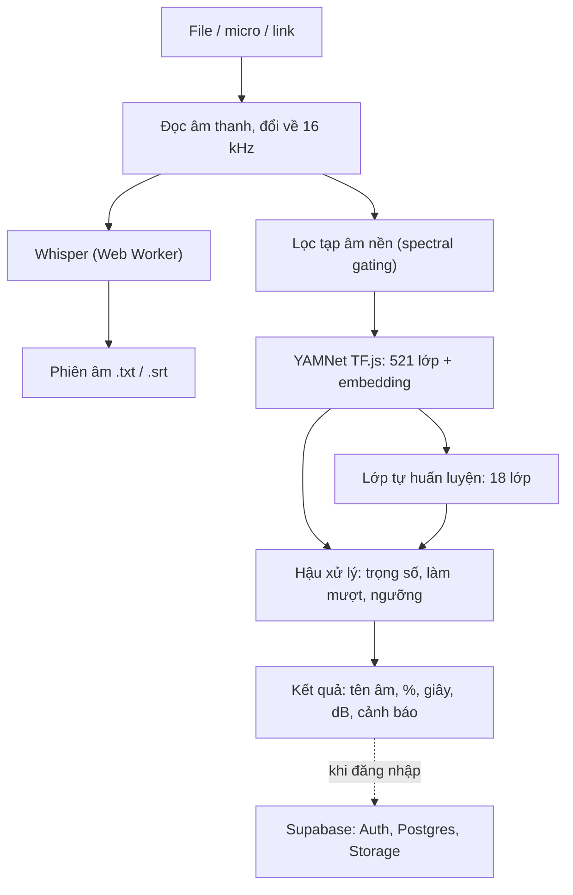

- **Không có server Python.** Web là các trang HTML tĩnh trên Vercel; AI chạy bằng TensorFlow.js và Transformers.js ngay trong trình duyệt. Backend là Supabase (dịch vụ có sẵn).
- **Quyền riêng tư:** âm thanh và hình camera được xử lý trên máy người dùng. Chỉ lịch sử nhận diện được đồng bộ, và chỉ khi người dùng đăng nhập.
- **Web vẫn chạy đầy đủ khi không cấu hình Supabase:** đăng nhập chuyển sang chế độ demo, dữ liệu lưu trong trình duyệt.
- **Vì sao không dùng CNN của bản cũ trên web:** CNN 10 lớp ép mọi âm lạ vào một trong 10 nhãn (ví dụ tiếng sủa trên nền máy lạnh bị nhận thành máy lạnh), và Vercel không chạy được PyTorch. Mã Flask + CNN vẫn được giữ trong `legacy/` để báo cáo và so sánh (xem [Đánh giá mô hình](#đánh-giá-mô-hình)).

### Công nghệ sử dụng

| Lớp | Công nghệ |
| --- | --- |
| Giao diện | HTML, CSS, JavaScript module thuần (không cần build), giao diện sáng/tối |
| AI trong trình duyệt | TensorFlow.js 4.22 + YAMNet (Google), Transformers.js 3 + Whisper (OpenAI), Web Audio API, AudioWorklet |
| Backend (có sẵn) | Supabase: Auth (Google, mã email), Postgres, Row Level Security, Storage |
| Serverless | Vercel Function `api/fetch-audio.js` để tải hộ âm thanh từ link |
| Học máy (offline) | Python, TensorFlow, librosa; Google Colab (`training/train_colab.ipynb`) |
| Mô hình bản cũ | PyTorch, Flask (CNN 2D trên Log-Mel, trong `legacy/`) |
| Dữ liệu | UrbanSound8K, ESC-50, Google AudioSet, Freesound, mẫu nhóm tự thu |
| Kiểm thử | Node test runner (`node --test`) |
| Triển khai | GitHub, Vercel (tự deploy khi push lên `main`) |

### Kết quả chính

| Chỉ số | Kết quả |
| --- | --- |
| Số loại âm thanh nhận được | 521 lớp YAMNet, gom thành 41 nhóm tiếng Việt |
| Lớp tự huấn luyện thêm (18 lớp), độ chính xác theo đoạn | 75,1% |
| CNN bản cũ trên UrbanSound8K, Test Fold 10 | Accuracy 79,45%, macro-F1 0,812 |
| CNN bản cũ trên 4 lớp tương ứng của ESC-50 | Accuracy 75,0% (160 đoạn) |
| Kiểm thử tự động | 18/18 đạt |

> Số liệu CNN đọc từ `assets/data/cnn_metrics.json` và `assets/data/cnn_esc50_eval.json`. Độ chính xác 75,1% của lớp tự huấn luyện lấy từ `models/custom/head.json`, đo trên tập kiểm tra tách theo file; con số này không so sánh trực tiếp được với 79,45% vì khác dữ liệu và khác số lớp.

## Hướng dẫn cài đặt và chạy ứng dụng

### Yêu cầu

- Chrome hoặc Edge (micro chỉ hoạt động trên `localhost` hoặc HTTPS).
- Node.js 18 trở lên **hoặc** Python 3 (chỉ cần một trong hai để mở web server tĩnh).
- Python 3.10+ chỉ khi muốn huấn luyện thêm dữ liệu.

### Chạy web

```bash
git clone https://github.com/vxphuswe/urban-sound.git
cd urban-sound
npm run dev                  # = npx serve -l 3000 .  →  mở http://localhost:3000
# hoặc
python -m http.server 3000
```

- **Không mở `index.html` bằng cách bấm đúp:** trình duyệt sẽ chặn micro và mô hình.
- **Lần đầu mở trang Nhận diện,** web tải YAMNet (khoảng 15 MB) rồi lưu lại. Repo đã có sẵn bản tự host trong `models/yamnet/`; muốn tải lại thì chạy `npm run download-model`.
- **Thêm `?demo` vào cuối địa chỉ** (ví dụ `nhan-dien.html?demo`) để xem giao diện khi không có mạng. Ở chế độ này, kết quả là giả lập.

### Kiểm tra mã

```bash
npm test                     # chạy 18 bài kiểm thử trong tests/
```

### Bật đăng nhập (tùy chọn)

Điền `SUPABASE_URL` và `SUPABASE_ANON_KEY` (khóa publishable/anon, là khóa công khai) vào `assets/js/config.js`, rồi chạy `supabase/schema.sql` và `supabase/samples.sql` trong Supabase → SQL Editor. Hướng dẫn đầy đủ ở [Thông tin bổ sung](#đăng-nhập-thật-supabase). **Không bao giờ dán khóa `service_role` vào code.**

### Lỗi thường gặp

| Hiện tượng | Cách sửa |
| --- | --- |
| Micro không chạy | Mở bằng `localhost` hoặc HTTPS, không mở file trực tiếp; bấm ổ khóa cạnh thanh địa chỉ → Micro → Cho phép |
| Báo "Không tải được thư viện AI" | Kiểm tra mạng; mạng trường hoặc công ty có thể chặn, thử mạng khác |
| Cổng 3000 đang được dùng | Đổi cổng, ví dụ `python -m http.server 8080` rồi mở `http://localhost:8080` |
| Trang không đổi sau khi sửa code | Nhấn `Ctrl + F5` để tải lại hoàn toàn |

## Task 1 — Project Planning & Teamwork

### (a) Phân công vai trò

| Thành viên | Phụ trách |
| --- | --- |
| Võ Xuân Phú | Lập kế hoạch và điều phối; dữ liệu và tiền xử lý; huấn luyện, đánh giá CNN (10-fold, SpecAugment) và lớp tự huấn luyện; toàn bộ web (10 trang, nhận diện, giám sát, đo ồn, phiên âm, dạy AI); Supabase; GitHub và triển khai Vercel; báo cáo và slide |
| Đinh Phùng Duy Huy | Hỗ trợ tìm hiểu dữ liệu, EDA và đối chiếu số liệu trong báo cáo |
| Tôn Thất Dương Đạt | Hỗ trợ tìm tài liệu tham khảo, chạy thử thí nghiệm và kiểm thử web |
| Lê Văn Tiến Hùng | Hỗ trợ làm slide và thuyết trình |

Phân công theo từng tuần ghi ở mục "Who" của mỗi [báo cáo tuần](#self-reports).

### (b) Thiết kế giao diện

Giao diện được thiết kế trước khi code, dựa trên các trang mẫu nhóm sưu tầm (bố cục chia đôi của trang đăng nhập, thang mức âm thanh, thẻ kết quả lớn) và các góp ý ở bản đầu tiên:

| Góp ý ở bản đầu | Cách xử lý trong thiết kế mới |
| --- | --- |
| Toàn thuật ngữ (dBFS, Log-Mel, Grad-CAM…) | Chỉ hiện tên âm thanh, %, mức ồn "Nhỏ / Vừa / To / Rất ồn"; chi tiết kỹ thuật gom vào ô riêng |
| Trẻ em chơi đùa cũng hiện cảnh báo vàng | Màu theo loại: đỏ chỉ cho nguy hiểm thật; trẻ em, âm nhạc màu xanh |
| Phải kéo 3 thanh trượt | Nút chọn nhanh độ nhạy Thấp / Trung bình / Cao |
| Bắt buộc bật camera | Chỉ cần micro; camera là tùy chọn, AI không phân tích hình |
| Mọi thứ dồn một trang | 10 trang riêng, menu có icon, hướng dẫn đặt lên đầu |

Màu sắc, bo góc, khoảng cách và chuyển động là biến CSS trong `assets/css/app.css`. Quy ước giao diện ở [`CONTRIBUTING.md`](CONTRIBUTING.md).

### (c) Project Plan

Dự án chia thành 5 tuần; sản phẩm tuần trước là đầu vào của tuần sau. Mỗi tuần có một báo cáo riêng.

| Tuần | Nội dung | Kết quả bàn giao | Báo cáo |
| --- | --- | --- | --- |
| 1 | Khởi động dự án | Đề tài, SWOT, kế hoạch giao tiếp, WBS, lộ trình, khung GitHub | [PDF](docs/weekly/BaoCao_Tuan1_UrbanSound.pdf) · [Word](docs/weekly/BaoCao_Tuan1_UrbanSound.docx) |
| 2 | Bài toán và hiểu dữ liệu | Phát biểu bài toán, 3 câu hỏi nghiên cứu, khám phá UrbanSound8K | [PDF](docs/weekly/BaoCao_Tuan2_UrbanSound.pdf) · [Word](docs/weekly/BaoCao_Tuan2_UrbanSound.docx) |
| 3 | Chuẩn bị dữ liệu và mô hình cơ sở | Pipeline tiền xử lý, ảnh Log-Mel, CNN 2D baseline | [PDF](docs/weekly/BaoCao_Tuan3_UrbanSound.pdf) · [Word](docs/weekly/BaoCao_Tuan3_UrbanSound.docx) |
| 4 | Phát triển và đánh giá mô hình | Huấn luyện, 10-fold, so sánh mô hình, phân tích lỗi, web Flask | [PDF](docs/weekly/BaoCao_Tuan4_UrbanSound.pdf) · [Word](docs/weekly/BaoCao_Tuan4_UrbanSound.docx) |
| 5 | Tích hợp cuối và bàn giao | Chuyển sang YAMNet trong trình duyệt, 10 trang web, Supabase, Vercel, báo cáo cuối | [PDF](docs/weekly/BaoCao_Tuan5_UrbanSound.pdf) · [Word](docs/weekly/BaoCao_Tuan5_UrbanSound.docx) |

### (d) GitHub Repository

```
*.html        10 trang web + 404
assets/       giao diện (css/), mã nguồn (js/), số liệu mô hình cũ (data/), ảnh
api/          Vercel Function tải âm thanh từ link
models/       YAMNet tự host (yamnet/), lớp tự huấn luyện (custom/head.json)
training/     script Python và notebook Colab để huấn luyện thêm
supabase/     SQL tạo bảng lịch sử và kho mẫu, có Row Level Security
tests/        kiểm thử tự động (Node)
tools/        tải mô hình YAMNet về tự host
legacy/       bản cũ: Flask + CNN UrbanSound8K
docs/
├── final-report/   báo cáo cuối kỳ (PDF, Word)
├── weekly/         báo cáo tuần 1–5 (PDF, Word)
└── screenshots/    ảnh chụp màn hình
.github/      mẫu pull request
```

### (e) Quy trình làm việc trên GitHub

- `main` luôn chạy được, vì Vercel deploy từ nhánh này.
- Mỗi việc một nhánh: `ten/viec-ngan-gon` (ví dụ `phu/loc-tap-am`). Không push thẳng vào `main`.
- Mở pull request theo [mẫu PR](.github/pull_request_template.md): mô tả thay đổi, ảnh chụp nếu sửa giao diện, đã chạy `npm run dev` và `npm test`, không commit file âm thanh gốc, `.env` hay khóa bí mật.
- Vercel tự tạo link xem thử cho mỗi pull request; có ít nhất một người duyệt rồi mới **Squash and merge**.
- Commit viết tiếng Việt, ngắn, nói rõ thay đổi gì.

Quy ước chi tiết: [`CONTRIBUTING.md`](CONTRIBUTING.md).

## Task 2 — Implement User Interface

### (a) Các trang đã xây dựng

| Địa chỉ | Trang |
| --- | --- |
| `index.html` | Trang chủ: giới thiệu, danh sách âm thanh nhận diện được, hành trình nghe (bộ sưu tập, chuỗi ngày, huy hiệu), hỏi đáp |
| `huong-dan.html` | Hướng dẫn từng bước, ý nghĩa màu sắc, danh sách nhóm âm thanh, xử lý lỗi micro |
| `nhan-dien.html` | Tải file, ghi âm hoặc dán link → "Đây là tiếng chó sủa (96%)", dòng thời gian, mức dB, cảnh báo sức khỏe, phiên âm |
| `truc-tiep.html` | Giám sát liên tục qua micro, 5 lớp cao nhất, dòng thời gian 60 giây, báo động, phụ đề trực tiếp, quay video kèm kết quả |
| `do-on.html` | Máy đo decibel: đồng hồ đổi màu, nhỏ nhất / trung bình / lớn nhất, biểu đồ 60 giây, so sánh mức ồn |
| `suc-khoe.html` | Thời gian nghe an toàn theo NIOSH (85 dB trong 8 giờ, cứ thêm 3 dB thì giảm một nửa), cách bảo vệ tai |
| `du-lieu.html` | Âm thanh của tôi: thu mẫu, dạy AI âm thanh riêng, gửi lên kho chung, tải gói .zip để huấn luyện |
| `lich-su.html` | Lịch sử kèm file âm thanh, mục yêu thích, tìm kiếm, lọc, xuất CSV |
| `dang-nhap.html` | Đăng nhập Google hoặc mã 6 số qua email, bố cục chia đôi màn hình |
| `gioi-thieu.html` | Kỹ thuật, so sánh với CNN bản cũ (confusion matrix, F1 theo lớp), quyền riêng tư, ghi nguồn |

### Ảnh chụp màn hình

| Trang chủ | Nhận diện |
| --- | --- |
| 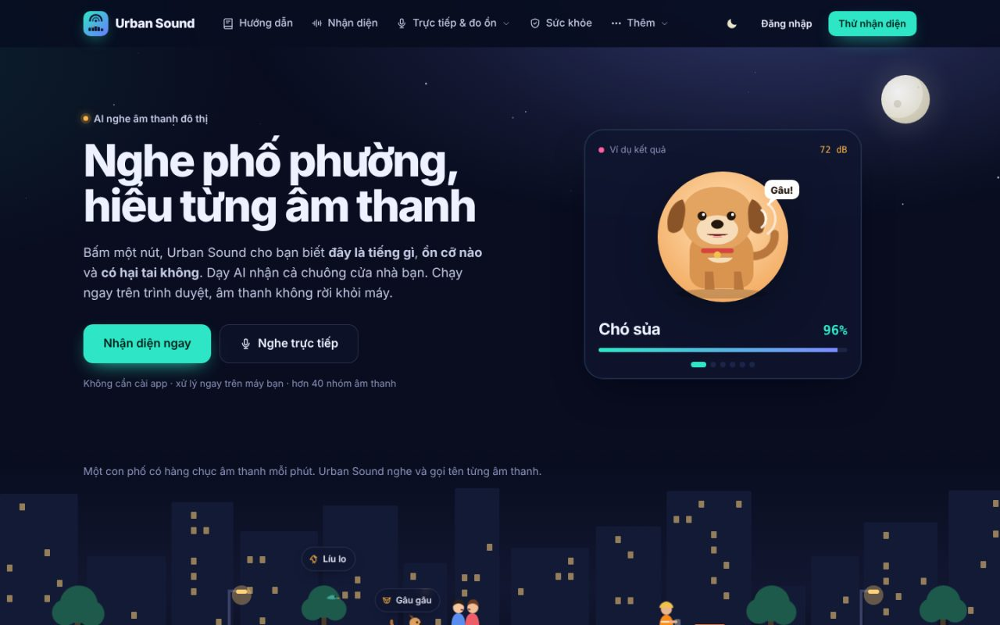 | 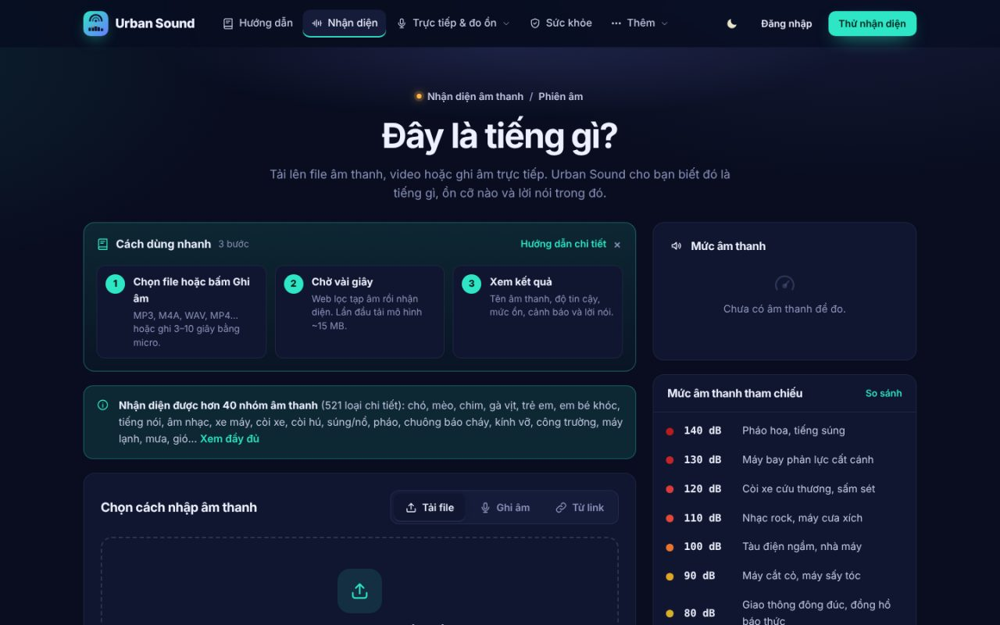 |
| Lời giới thiệu, ví dụ âm thanh có minh họa động và con phố ban đêm. | Chọn file, ghi âm hoặc dán link; khung lưu ý về các loại âm nhận được. |
| **Giám sát trực tiếp** | **Máy đo decibel** |
| 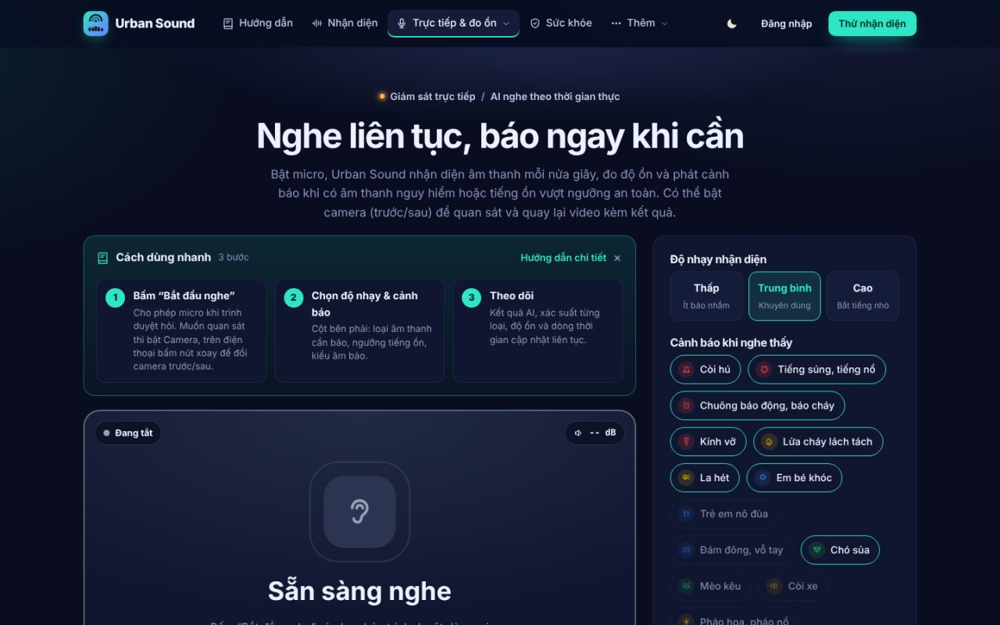 | 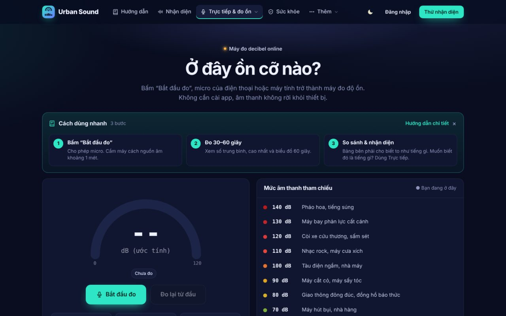 |
| Độ nhạy Thấp / Trung bình / Cao, chọn loại âm cần báo, trạng thái micro. | Đồng hồ đổi màu theo mức ồn và bảng mức tham chiếu. |
| **Sức khỏe** | **Dạy AI (Âm thanh của tôi)** |
| 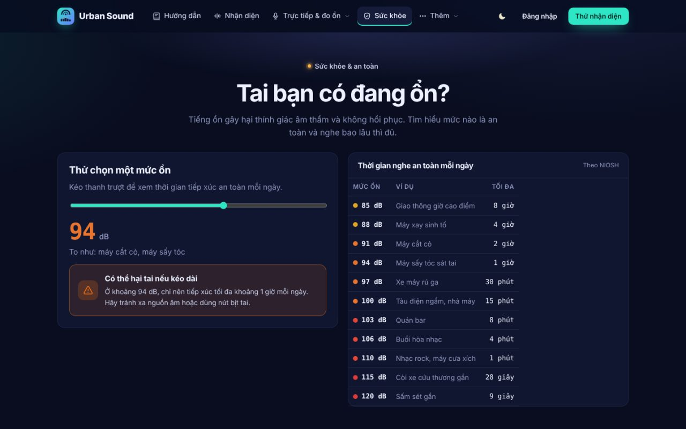 | 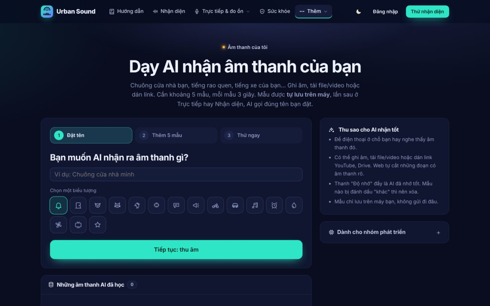 |
| Chọn một mức ồn để xem nghe tối đa bao lâu mỗi ngày. | Thu vài mẫu, đặt tên, AI nhận ra ở lần sau. |
| **Hướng dẫn** | **Lịch sử và yêu thích** |
| 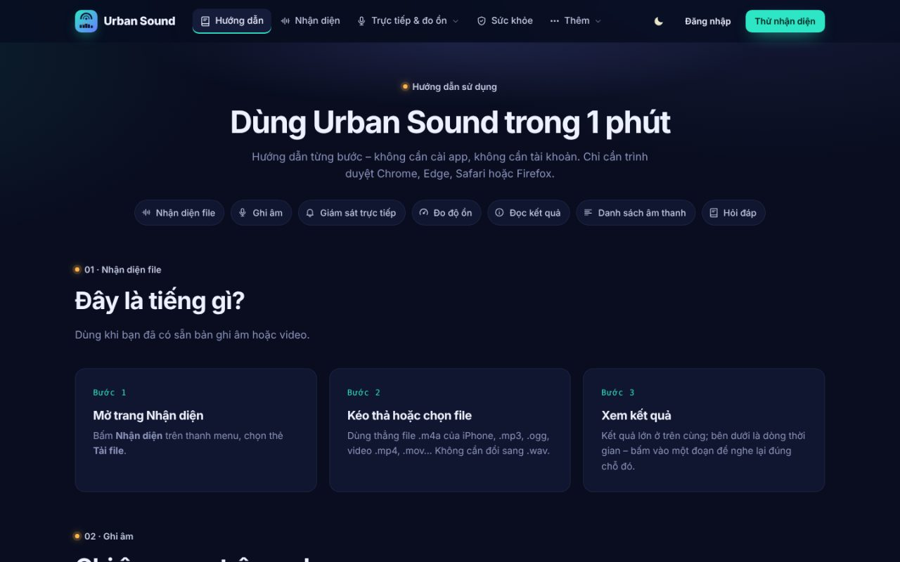 | 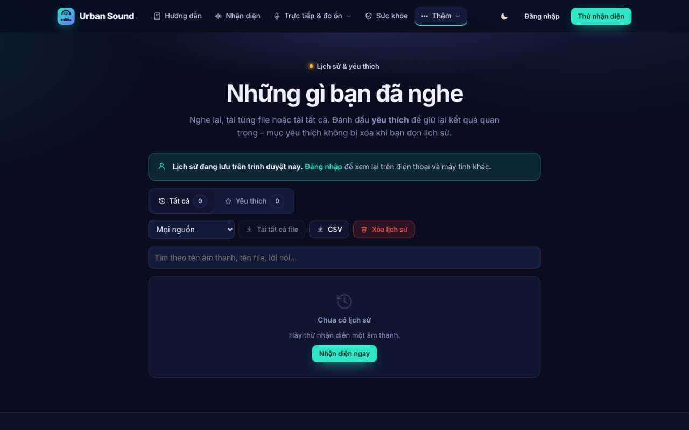 |
| Các bước dùng, ý nghĩa màu sắc và cách xử lý lỗi micro. | Tìm, lọc, nghe lại, đánh dấu yêu thích và xuất CSV. |
| **Đăng nhập** | **Giới thiệu và mô hình** |
| 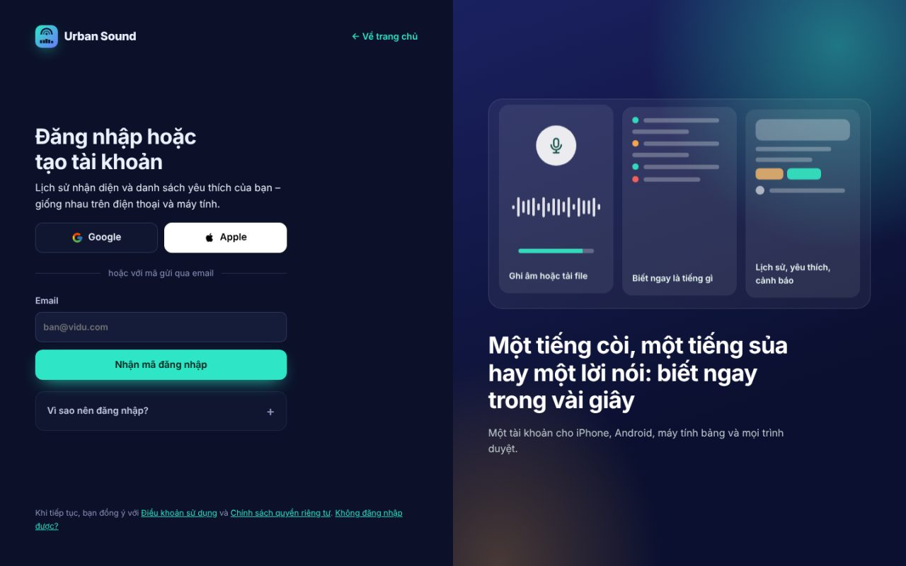 | 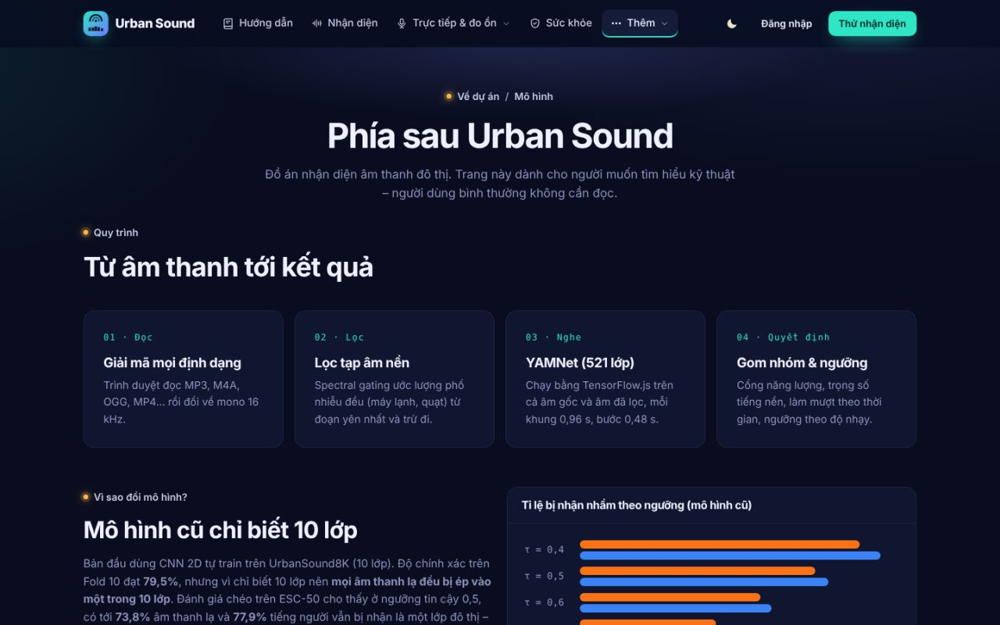 |
| Google hoặc mã 6 số qua email, bố cục chia đôi. | Kỹ thuật, so sánh với CNN bản cũ, quyền riêng tư. |

*Ảnh chụp ở chế độ `?demo`, màn hình 1440 × 900.*

### (b) Giao diện và CSS

- Một file `assets/css/app.css` cho toàn bộ web, không dùng framework. Màu, bo góc, font (Be Vietnam Pro) và chuyển động khai báo bằng biến CSS, nên đổi giao diện chỉ cần sửa biến.
- Giao diện ngày và đêm, đổi bằng một nút trên thanh menu và nhớ lựa chọn của người dùng.
- Tôn trọng cài đặt giảm chuyển động của hệ điều hành (`prefers-reduced-motion`).

### (c) Các tính năng tương tác

- **Kết quả dễ hiểu:** thẻ kết quả lớn kèm minh họa động (chó vẫy đuôi "Gâu!", mèo, chim, trẻ em); viền đổi màu khi âm thanh to.
- **Cảnh báo theo mức độ:** đỏ chỉ dành cho nguy hiểm thật; báo động toàn màn hình kèm âm báo và rung trên điện thoại.
- **Dòng thời gian:** biết âm thanh xuất hiện ở giây nào; bấm vào để nghe lại đúng đoạn đó.
- **Phiên âm:** chỉ phiên âm đoạn có tiếng người, chọn mức Nhanh / Cân bằng / Chính xác; phụ đề trực tiếp trong khung camera.
- **Dạy AI:** ghi âm, chọn file hoặc dán link YouTube / Google Drive; web tự cắt đoạn có âm thanh, nghe lại, đổi nhãn.
- **Hành trình nghe:** bộ sưu tập âm thanh đã gặp, chuỗi ngày dùng liên tiếp và huy hiệu.

### (d) Giao diện trên nhiều thiết bị

- **Máy tính:** menu ngang có menu thả xuống, nội dung chia cột.
- **Điện thoại:** menu thu gọn, thẻ xếp dọc, camera nằm gọn trong khung, không tràn ngang; có các mốc thiết kế 980, 900, 820, 640 và 380 px.
- **Micro trên điện thoại** chạy được nhờ Vercel có sẵn HTTPS; camera đổi được trước và sau.

## Task 3 — Database Integration & Dynamic Content

### (a) Thiết kế cơ sở dữ liệu

Postgres trên Supabase, tạo bằng `supabase/schema.sql` và `supabase/samples.sql`. Không lưu âm thanh của người dùng trừ khi họ chủ động bấm "Gửi lên kho chung".

| Thành phần | Nội dung |
| --- | --- |
| Bảng `public.detections` | Lịch sử nhận diện của từng tài khoản: thời gian, nguồn (file, video, micro, trực tiếp), tên file, nhóm âm thanh, độ tin cậy, mức ồn trung bình và cao nhất, thời lượng, lời phiên âm, yêu thích. Xóa tài khoản thì lịch sử bị xóa theo (`on delete cascade`) |
| Storage bucket `samples` | Kho mẫu âm thanh chung để huấn luyện thêm; mỗi người một thư mục theo `user_id` |
| Row Level Security | Bật trên bảng và bucket: mỗi người chỉ đọc, thêm, sửa, xóa dữ liệu của mình |
| Xác thực | Supabase Auth: Google OAuth và mã 6 số gửi qua email |

### (b) Kết nối cơ sở dữ liệu

- Web dùng `@supabase/supabase-js`, chỉ tải khi cần (dynamic import), với URL và khóa publishable trong `assets/js/config.js`. Khóa bí mật không bao giờ nằm trong frontend.
- Lịch sử và mục yêu thích lưu trước trong trình duyệt (`localStorage`); file âm thanh và mẫu tự thu lưu trong IndexedDB, nên mở lại web vẫn còn. Khi đăng nhập, lịch sử được đồng bộ lên Supabase.
- Chưa cấu hình Supabase thì web chạy chế độ demo: mã 6 số hiện ngay trên màn hình, tài khoản chỉ lưu trong trình duyệt.

### (c) Các trang hiển thị dữ liệu động

| Trang | Dữ liệu |
| --- | --- |
| `lich-su.html` | Lịch sử nhận diện, file âm thanh kèm theo, mục yêu thích; lọc và xuất CSV |
| `du-lieu.html` | Mẫu tự thu (IndexedDB), lớp âm thanh riêng, kho mẫu chung trên Supabase Storage |
| `index.html` | Hành trình nghe: bộ sưu tập, chuỗi ngày, huy hiệu |
| `dang-nhap.html` | Trạng thái tài khoản, tên người dùng sau khi đăng nhập |
| `gioi-thieu.html` | Confusion matrix và F1 theo lớp của CNN, tính trực tiếp từ `assets/data/cnn_metrics.json`, không có số viết tay trong code |

## Task 4 — Optimization

### (a) Hiệu năng

Các thay đổi đã làm để web nhẹ và nhanh:

- **Không có bước build:** trang HTML tĩnh, JavaScript module chỉ tải đúng phần mỗi trang cần (`assets/js/pages/*.js`).
- **Tự host YAMNet** trong `models/yamnet/` (khoảng 15 MB) và cache 7 ngày (`vercel.json`), không phụ thuộc TF Hub.
- **Whisper chỉ tải khi người dùng bấm phiên âm** và chạy trong Web Worker, nên giao diện không bị đứng.
- **Thu âm bằng AudioWorklet** thay cho ScriptProcessor, giảm trễ khi nghe trực tiếp.
- **Thư viện Supabase tải theo nhu cầu**, trang nào không cần đăng nhập thì không tải.
- **Chỉ phân tích 5 phút đầu** của file dài, có bước cắt khung lặng để bớt việc cho mô hình.

### (b) Bảo mật, theo dõi lỗi và hành vi người dùng

Web không dùng công cụ theo dõi bên thứ ba (Google Analytics, Sentry…). Đây là lựa chọn có chủ đích: web xử lý micro và camera, nên nhóm giữ nguyên tắc không gửi âm thanh của người dùng ra ngoài. Thay vào đó:

- **Header bảo mật trên Vercel:** micro và camera chỉ cho chính trang web (`Permissions-Policy`), `X-Content-Type-Options: nosniff`, `Referrer-Policy`.
- **Hàm `api/fetch-audio.js` chống SSRF:** chỉ nhận link http/https, chặn địa chỉ nội bộ, chỉ nhận file âm thanh/video, tối đa khoảng 4 MB.
- **Thông báo lỗi rõ nguyên nhân:** micro bị chặn, camera không mở được, mất mạng khi tải mô hình, file không đọc được; mỗi lỗi kèm cách sửa.
- **Nhật ký phiên** ở trang Trực tiếp và lịch sử nhận diện cho biết người dùng hay gặp âm thanh gì; dữ liệu này nằm trên máy người dùng.

### (c) Kết quả kiểm thử

Chạy ngày 25/11/2026 bằng `npm test` (Node 22):

| Bộ test | Nội dung | Kết quả |
| --- | --- | --- |
| `tests/analysis.test.mjs` (16 bài) | Hậu xử lý chống nhận nhầm: chó sủa trên nền máy lạnh phải ra "chó sủa"; chỉ có máy lạnh thì báo tiếng nền; phòng im lặng thì báo yên tĩnh; tạp âm nhỏ không thành sự kiện; lọc tạp âm vẫn giữ tiếng sủa ngắn; lớp tự huấn luyện không biến tiếng người nói thành "mèo"; nhận diện đám đông | 16/16 đạt |
| `tests/head.test.mjs` | Lớp tự huấn luyện chạy bằng JavaScript cho cùng kết quả với numpy lúc huấn luyện | 1/1 đạt |
| `tests/fetch-audio.test.mjs` | Chặn địa chỉ nội bộ, cho phép địa chỉ công khai | 1/1 đạt |
| **Tổng** | | **18/18 đạt** |

> Các bài kiểm thử dùng điểm số giả lập của mô hình, nên chúng kiểm tra luồng xử lý chứ không đo độ chính xác của YAMNet.

## Đánh giá mô hình

### CNN bản cũ trên UrbanSound8K

CNN 2D (405.898 tham số) trên ảnh phổ Log-Mel 128 × 173, chia theo fold gốc: train Fold 1–8, validation Fold 9, test Fold 10. Quá trình xây dựng mô hình này được trình bày ở [báo cáo Tuần 3](docs/weekly/BaoCao_Tuan3_UrbanSound.pdf) và [Tuần 4](docs/weekly/BaoCao_Tuan4_UrbanSound.pdf).

| Chỉ số (Test Fold 10, 837 đoạn) | Kết quả |
| --- | --- |
| Accuracy | 79,45% (665/837) |
| Macro-F1 | 0,812 |
| Validation accuracy tốt nhất | 78,43% (epoch 29) |
| Lớp tốt nhất | gun_shot (F1 0,955), car_horn (0,906) |
| Lớp kém nhất | children_playing (0,70), siren (0,72) |
| Nhầm nhiều nhất | siren → children_playing (19/83), air_conditioner → children_playing (15/100) |

### Vì sao chuyển sang YAMNet

Đánh giá chéo trên ESC-50 cho thấy CNN 10 lớp chưa dùng thật được:

- **Với âm thanh cùng loại**, độ chính xác trên 4 lớp tương ứng của ESC-50 chỉ còn 75,0%. Riêng còi xe chỉ đạt 52,5%.
- **Với âm thanh ngoài 10 lớp** (mưa, gió, bàn phím… 560 đoạn), mô hình vẫn gán nhãn khá tự tin, độ tin cậy trung bình 0,66. Ở ngưỡng 0,7, vẫn còn 42,7% số đoạn bị gán nhầm một nhãn đô thị.

YAMNet đã biết 521 lớp, trong đó có tiếng người nói và tiếng nền. Vì vậy âm thanh lạ được gọi đúng nhóm của nó, thay vì bị ép vào một nhãn đô thị. Phân tích đầy đủ ở [báo cáo cuối kỳ](docs/final-report/UrbanSound_Final_Report.pdf).

### Lớp tự huấn luyện thêm

Lớp phân loại nhỏ (2 tầng) huấn luyện trên embedding 1024 chiều của YAMNet bằng các script trong `training/`. Script lấy dữ liệu từ UrbanSound8K, ESC-50, AudioSet, Freesound và mẫu nhóm tự thu, có trộn tạp âm thật khi huấn luyện. Lớp này gồm 18 lớp, độ chính xác theo đoạn **75,1%** trên tập kiểm tra tách theo file. Trong đó có 4 lớp âm thanh Việt Nam mà YAMNet chưa có (tiếng rao bán hàng, chuông chùa, tiếng mõ, trống lân) và một lớp tiếng nền để giảm báo nhầm.

## Deliverables Checklist

- [x] Mã nguồn trên GitHub (repo này), kèm README
- [x] Báo cáo cuối kỳ theo mẫu IEEE: [PDF](docs/final-report/UrbanSound_Final_Report.pdf) · [Word](docs/final-report/UrbanSound_Final_Report.docx)
- [x] Báo cáo từng tuần (tuần 1–5): xem [Self-Reports](#self-reports)
- [x] Bản chạy trên Vercel: https://urban-sound-ai.vercel.app
- [x] Slide thuyết trình từng tuần (nộp trên Drive)
- [x] Video demo (nộp trên Drive)
- [ ] Điểm Lighthouse ở [Task 4 (a)](#a-hiệu-năng)
- [ ] Bản tự nhìn lại cá nhân viết tay (4 thành viên)

## Self-Reports

Mỗi báo cáo tuần mở đầu bằng bảng **Tóm mục báo cáo tuần** gồm 8 mục: What, When, Why, Who, How much, Top risks, Major changes, Key issues; sau đó là phần chuyên đề của tuần. Bấm **PDF** để xem ngay trên GitHub, **Word** để tải bản chỉnh sửa được.

| Tuần | Tiêu đề | Nội dung chính | Báo cáo |
| --- | --- | --- | --- |
| 1 | Khởi động dự án | Tổng quan dự án, giải pháp AI, dữ liệu, SWOT, vai trò, kế hoạch giao tiếp, WBS, lộ trình, GitHub | [PDF](docs/weekly/BaoCao_Tuan1_UrbanSound.pdf) · [Word](docs/weekly/BaoCao_Tuan1_UrbanSound.docx) |
| 2 | Bài toán và hiểu dữ liệu | Phát biểu bài toán, 3 câu hỏi nghiên cứu, khám phá và chất lượng dữ liệu, rà soát baseline | [PDF](docs/weekly/BaoCao_Tuan2_UrbanSound.pdf) · [Word](docs/weekly/BaoCao_Tuan2_UrbanSound.docx) |
| 3 | Chuẩn bị dữ liệu và mô hình cơ sở | Pipeline tiền xử lý, chia dữ liệu, Log-Mel, lý do chọn CNN, kết quả baseline | [PDF](docs/weekly/BaoCao_Tuan3_UrbanSound.pdf) · [Word](docs/weekly/BaoCao_Tuan3_UrbanSound.docx) |
| 4 | Phát triển và đánh giá mô hình | Kiến trúc, huấn luyện, chỉ số, so sánh mô hình, phân tích lỗi, kế hoạch cải tiến | [PDF](docs/weekly/BaoCao_Tuan4_UrbanSound.pdf) · [Word](docs/weekly/BaoCao_Tuan4_UrbanSound.docx) |
| 5 | Tích hợp cuối và bàn giao | Kết quả, sản phẩm (Flask và bản web công khai), giới hạn, hướng phát triển, bàn giao | [PDF](docs/weekly/BaoCao_Tuan5_UrbanSound.pdf) · [Word](docs/weekly/BaoCao_Tuan5_UrbanSound.docx) |
| Cuối kỳ | Báo cáo theo mẫu IEEE | Toàn bộ đồ án: dữ liệu, phương pháp, kết quả, đánh giá chéo ESC-50, tích hợp, hạn chế | [PDF](docs/final-report/UrbanSound_Final_Report.pdf) · [Word](docs/final-report/UrbanSound_Final_Report.docx) |

## Thông tin bổ sung

### Triển khai lên Vercel

1. Đăng nhập [vercel.com](https://vercel.com) bằng tài khoản GitHub.
2. **Add New → Project** → chọn repo `urban-sound` → **Import**.
3. Framework Preset: **Other**. Build Command và Output Directory: **để trống**.
4. Bấm **Deploy**. Từ đó mỗi lần push lên `main`, Vercel tự deploy; mỗi pull request có một link xem thử riêng.

`vercel.json` cấu hình quyền micro và camera, cache cho mô hình và các đường dẫn ngắn (`/nhan-dien`, `/truc-tiep`, `/do-on`, `/huong-dan`, `/dang-nhap`). `.vercelignore` loại `training/`, `legacy/`, `tests/`, `tools/`, `supabase/` khỏi bản deploy.

### Đăng nhập thật (Supabase)

1. Tạo project ở [supabase.com](https://supabase.com).
2. SQL Editor → chạy `supabase/schema.sql` (bảng lịch sử) và `supabase/samples.sql` (kho mẫu chung).
3. Project Settings → API: chép Project URL và khóa publishable/anon vào `assets/js/config.js`.
4. Authentication → URL Configuration: Site URL là địa chỉ Vercel; thêm `http://localhost:3000/**` và `https://<tên>.vercel.app/**` vào Redirect URLs.
5. **Mã 6 số qua email:** Authentication → Emails → Magic Link, thêm `{{ .Token }}` vào nội dung thư.
6. **Google:** tạo OAuth Client (Web) trong Google Cloud Console.
   - Authorized JavaScript origins: thêm địa chỉ web.
   - Authorized redirect URIs: thêm `https://<project>.supabase.co/auth/v1/callback` và `https://urban-sound-ai.vercel.app/dang-nhap.html`.
   - Dán Client ID và Secret vào Supabase → Providers → Google, và chép Client ID vào `GOOGLE_CLIENT_ID` trong `config.js` để cửa sổ Google hiện tên web.

### Huấn luyện thêm dữ liệu

Tóm tắt (chi tiết ở [`training/README.md`](training/README.md), hoặc chạy notebook `training/train_colab.ipynb` trên Google Colab):

```bash
cd training
pip install -r requirements.txt
python 00_download_freesound.py       # cần FREESOUND_API_KEY
python 00_download_audioset.py        # cần yt-dlp và ffmpeg
python 01_prepare_data.py
python 02_extract_embeddings.py --augment 3
python 03_train_head.py               # xuất ../models/custom/head.json
python 04_predict.py duong-dan-file.m4a
```

Thêm một loại âm thanh mới bằng cách khai báo trong `training/sounds_to_collect.json` (tên tiếng Việt, màu, số mẫu, từ khóa Freesound, nhãn AudioSet), rồi chạy lại các bước trên. Commit `models/custom/head.json` là web tự dùng mô hình mới.

### Cấu hình chính (`assets/js/config.js`)

| Khóa | Ý nghĩa |
| --- | --- |
| `SENSITIVITY` | Ngưỡng của 3 mức độ nhạy Thấp / Trung bình / Cao |
| `DENOISE_DEFAULT` | Bật lọc tạp âm nền trước khi nhận diện |
| `ASR_MODELS`, `ASR_DEFAULT` | Các mức Whisper: tiny (~40 MB), base (~80 MB, mặc định), small (~250 MB) |
| `CALIBRATION_DB` | Hệ số đổi từ mức tín hiệu sang dB ước tính (mặc định +96) |
| `HEALTH_LIMIT_DB` | Ngưỡng cảnh báo sức khỏe (85 dB) |
| `MAX_ANALYZE_SEC` | Thời lượng tối đa phân tích trong một file (300 giây) |

### Giới hạn hiện tại

- **Số dB là ước tính** từ micro thông thường, không thay được máy đo đã hiệu chuẩn; có thể chỉnh hệ số trong Trực tiếp → Cài đặt nâng cao.
- **Người giả tiếng sủa vẫn là giọng người,** nên YAMNet có thể trả về "tiếng người nói". Cần thu thêm dữ liệu cho những trường hợp này.
- **Phiên âm tiếng Việt** bằng Whisper bản nhỏ đôi khi sai chính tả với giọng địa phương; nên chọn mức "Chính xác" nếu máy đủ mạnh.
- **Phụ đề trực tiếp** dùng Web Speech API: chạy tốt nhất trên Chrome và Edge, chưa hỗ trợ Firefox.
- **Lớp tự huấn luyện** mới đạt 75,1% theo đoạn; các lớp âm thanh Việt Nam còn ít mẫu.
- **Chưa đo độ chính xác của toàn hệ thống** trên âm thanh thu thật tại Việt Nam.

### Nguồn mô hình, dữ liệu và giấy phép

- YAMNet (Google, Apache 2.0), Whisper (OpenAI, MIT), TensorFlow.js, Transformers.js.
- UrbanSound8K và ESC-50 (CC BY-NC 3.0): chỉ dùng cho mục đích học tập, không đưa file âm thanh lên GitHub.
- Mẫu Freesound giữ giấy phép riêng của từng tác giả; danh sách ghi nguồn được tạo trong `training/` khi tải.
